  

  
  
  
  

  

  
  
  
  
  

  

  
  

  

  
  
  
  
  
  
  

  

  
  
  
  
  
  

<table align="center">
  <tr>
    <td width="50%" align="center"></td>
    <td width="50%" align="center"></td>
  </tr>
</table>

## 📊 My GitHub Stats

<table align="center">
  <tr>
    <td align="center"></td>
    <td align="center"></td>
    <td align="center"></td>
  </tr>
  <tr>
    <td align="center"></td>
    <td align="center"></td>
    <td align="center"></td>
  </tr>
</table>

